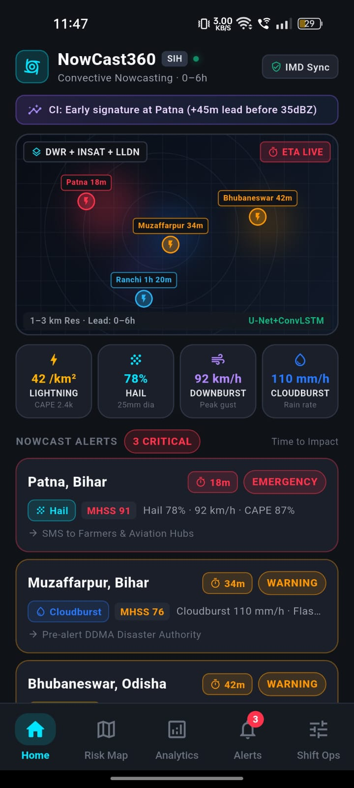
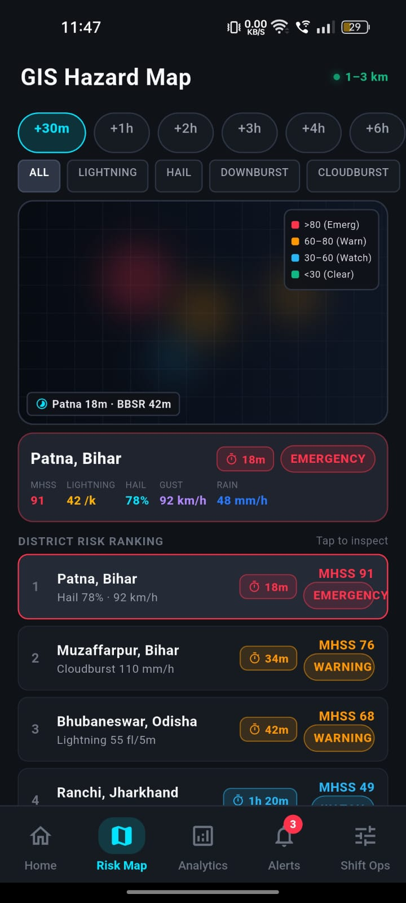
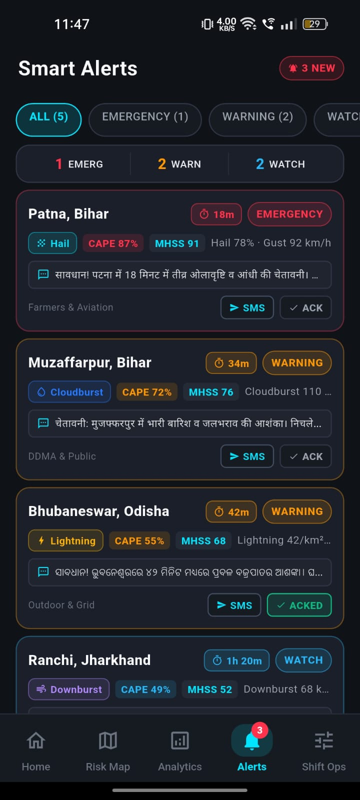
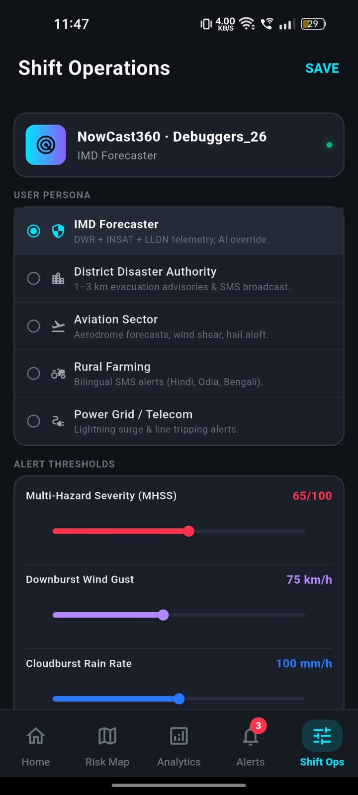
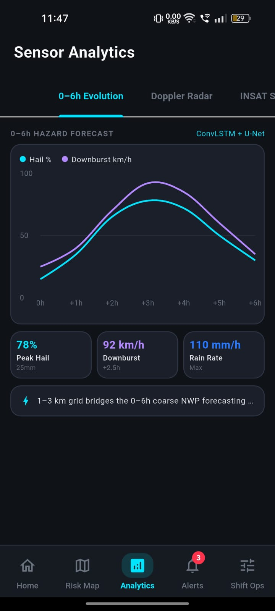
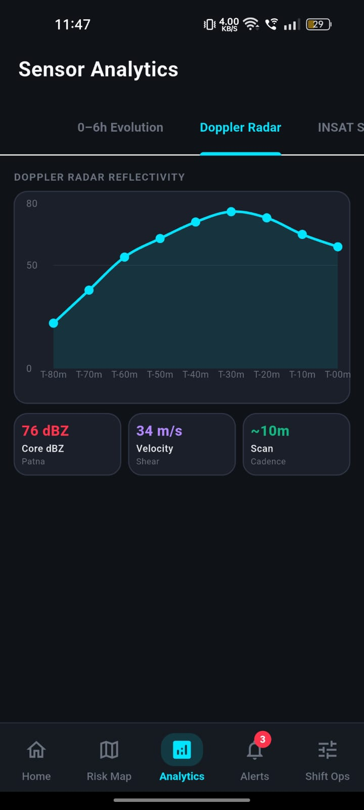
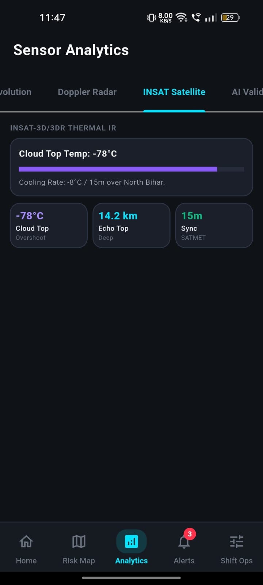
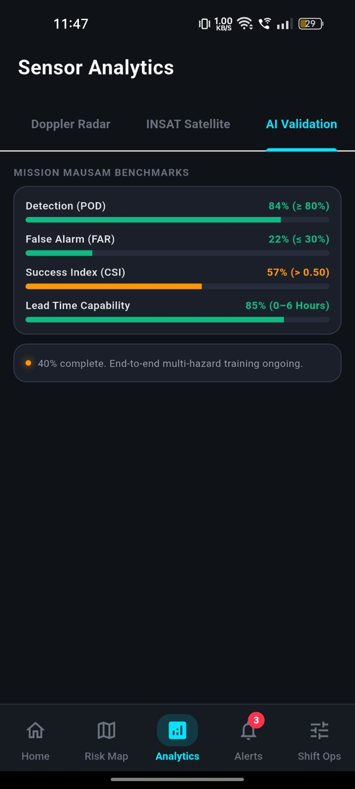
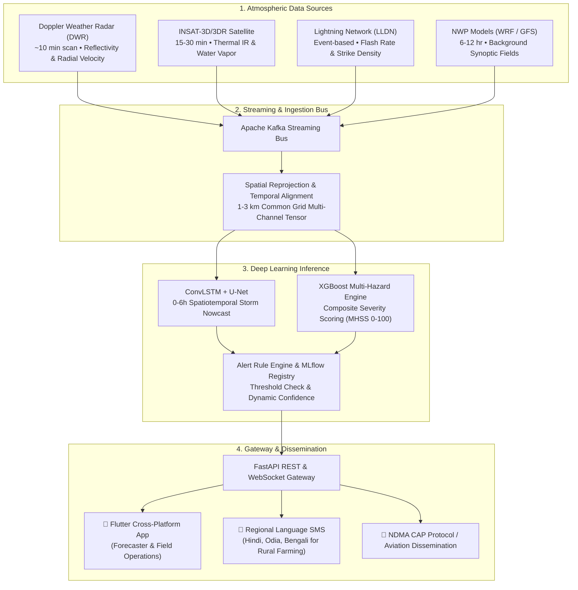

<h1 align="center">⚡ NowCast360</h1>
<p align="center">
  <strong>Hyper-Local Convective-Scale Severe Weather Nowcasting Platform</strong><br>
  <em>AI-Powered 0–6 Hour Forecasting at 1–3 km Spatial Resolution</em>
</p>

<p align="center">
  <a href="https://www.sih.gov.in/"></a>
  <a href="https://www.sih.gov.in/"></a>
  <a href="https://moes.gov.in/"></a>
  <a href="https://flutter.dev"></a>
  <a href="https://fastapi.tiangolo.com"></a>
  
</p>

<p align="center">
  <a href="#-application-showcase">Showcase</a> •
  <a href="#-key-capabilities">Key Capabilities</a> •
  <a href="#-core-hazards-monitored">Hazards</a> •
  <a href="#-system-architecture">Architecture</a> •
  <a href="#-technology-stack">Tech Stack</a> •
  <a href="#-quick-start">Quick Start</a>
</p>

---

### 🌐 Overview

**NowCast360** bridges the critical **0–6 hour forecasting void** where coarse NWP numerical models lose skill. By fusing **Doppler Weather Radar (DWR)**, **INSAT-3D/3DR Satellite**, and **ground lightning telemetry (LLDN)** into a unified multi-channel spatiotemporal tensor, NowCast360 delivers hyper-local **1–3 km spatial resolution** predictions for thunderstorms, damaging downburst winds, hail, and cloudbursts.

> **National Priority Alignment**: Developed for **Smart India Hackathon 2026** and aligned with Ministry of Earth Sciences (MoES) **Mission Mausam (2024–2026)** to upgrade convective storm lead time by 30–60 minutes and disseminate actionable alerts directly to district administrations and citizens.

---

## 📱 Application Showcase

### 1. Core Operational Screens

| 🏠 Home Dashboard & Radar Sweep | 🗺️ Interactive GIS Risk Map |
| :---: | :---: |
|  |  |
| **Real-time GIS radar sweep**<br/>• Live storm arrival countdown clocks (*Patna 18m*, *BBSR 42m*)<br/>• Early Convective Initiation (CI) notification banner<br/>• 4-hazard telemetry matrix (Lightning, Hail, Downburst, Rain) | **Hyper-local 1–3 km risk grid**<br/>• Interactive 0–6h forecast horizon slider (`+30m` to `+6h`)<br/>• Hazard toggles (Hail, Downburst, Cloudburst, Lightning)<br/>• District vulnerability rankings & drill-down metrics |

| 🔔 Smart Alerts & Dissemination | ⚙️ Shift Operations & Rule Engine |
| :---: | :---: |
|  |  |
| **Multilingual alert feed**<br/>• Severity categorization (`EMERGENCY`, `WARNING`, `WATCH`)<br/>• CAPE % and Multi-Hazard Severity Score (MHSS 0–100)<br/>• Regional language SMS broadcast preview (Hindi, Odia) & ACK | **Stakeholder-tailored operations**<br/>• Persona switcher (Forecaster, DDMA, Aviation, Farmer, Grid)<br/>• Dynamic alert threshold adjustment sliders<br/>• Real-time data pipeline telemetry & sync status |

<br/>

### 2. Multi-Sensor Analytics & AI Benchmarks

| 📈 0–6h Hazard Forecast Evolution | 📡 Doppler Weather Radar (DWR) |
| :---: | :---: |
|  |  |
| **ConvLSTM + U-Net predictive trend**<br/>Forecast evolution curve tracking Hail probability (%) and peak downburst wind speed over the 0–6 hour horizon. | **Reflectivity & velocity shear**<br/>Dual-pol DWR reflectivity curve reaching 76 dBZ core with 34 m/s radial velocity shear at ~10 min cadence. |

| 🛰️ INSAT Satellite Thermal IR | 🎯 Mission Mausam AI Benchmarks |
| :---: | :---: |
|  |  |
| **Thermal IR deep convection tracking**<br/>Cloud top overshoot temperature (-78°C) and echo top height (14.2 km) with 15-minute SATMET sync. | **Model verification scorecard**<br/>• Probability of Detection (POD): **84%** (Target ≥ 80%)<br/>• False Alarm Ratio (FAR): **22%** (Target ≤ 30%)<br/>• Critical Success Index (CSI): **0.57** (Target > 0.50) |

---

## 🌟 Key Capabilities

- **Multi-Sensor Data Fusion**: Merges Doppler Weather Radar (reflectivity, radial velocity), INSAT-3D/3DR (IR, water vapor), LLDN lightning strikes, and NWP (WRF/GFS) into a normalized spatiotemporal tensor.
- **Convective Initiation (CI) Detection**: Detects early storm signatures 30–60 minutes *before* radar reflectivity matures above 35 dBZ.
- **Actionable Arrival Countdowns**: Computes live "Time to Impact" countdown clocks for high-risk population centers.
- **Composite Hazard Scoring (MHSS)**: Unified 0–100 Multi-Hazard Severity Score computed per 1–3 km grid cell.
- **Multi-Tier Dissemination**: Automated dispatch to NDMA CAP protocols, aviation warnings, and bilingual SMS for farmers.

---

## 🎯 Core Hazards Monitored

| Hazard | Key Indicators & Telemetry | Forecast Output | Critical Action Threshold |
| :--- | :--- | :--- | :--- |
| ⚡ **Thunderstorm & Lightning** | LLDN flash rate, CAPE energy, CI index | Strike density / km², ETA countdown | > 40 strikes/km² · Emergency |
| 🌨️ **Hailstorm & Diameter** | Dual-pol radar differential reflectivity, VIL | Hail probability %, size in mm | > 25 mm hail dia · Warning |
| 💨 **Downburst Winds** | Radial velocity shear, microburst signature | Peak gust velocity (km/h) | > 75 km/h gusts · Aviation/Grid |
| 🌧️ **Cloudburst Precipitation** | Dual-sensor rain rate, moisture convergence | Extreme mm/hour precipitation | > 100 mm/h · Flash Flood |

---

## 🏗️ System Architecture

NowCast360 utilizes an event-driven streaming, deep learning inference, and push dissemination architecture:



---

## 🛠️ Technology Stack

| Layer | Technologies | Role & Highlights |
| :--- | :--- | :--- |
| **Mobile & Frontend** | **Flutter 3.x**, Dart, `flutter_map`, `fl_chart`, `latlong2` | Cross-platform (Android, iOS, Web, Desktop) with sleek grey/dark UI, radar sweep animations, and offline caching |
| **Streaming & Ingestion**| **Apache Kafka**, Python Adapters, GDAL | High-throughput streaming bus handling heterogeneous high-cadence radar and satellite raster feeds |
| **Storage & Persistence**| **TimescaleDB**, **PostgreSQL** (Master-Slave) | Optimized time-series indexing for multi-band radar scans and relational alert logs |
| **AI / Machine Learning**| **PyTorch**, **ConvLSTM**, **U-Net**, **XGBoost**, **MLflow** | Spatiotemporal nowcasting, CI early signature detection, and multi-hazard scoring |
| **Backend & Services** | **FastAPI**, WebSockets, Docker, Redis | Low-latency asynchronous REST/WebSocket server for live telemetry streaming |

---

## 🚀 Quick Start

### Prerequisites
- [Flutter SDK (3.x or higher)](https://flutter.dev/docs/get-started/install)
- Dart SDK (included with Flutter)
- Android Studio / VS Code with Flutter extension
- Connected physical device or emulator

### Running the App
```bash
# 1. Clone repository
git clone https://github.com/Adarsh-228/sih_2026_Noewcast360.git
cd sih_2026_Noewcast360

# 2. Install dependencies
flutter pub get

# 3. Verify static analysis
flutter analyze

# 4. Launch on connected device/emulator
flutter run
```

---

## 👥 Team Debuggers_26
Developed for **Smart India Hackathon 2026** under the **Disaster Management** Theme.  
Aligned with **Mission Mausam (2024–2026)**, Ministry of Earth Sciences (MoES), Govt. of India.
